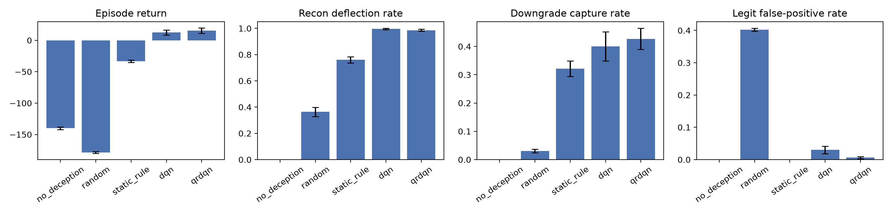
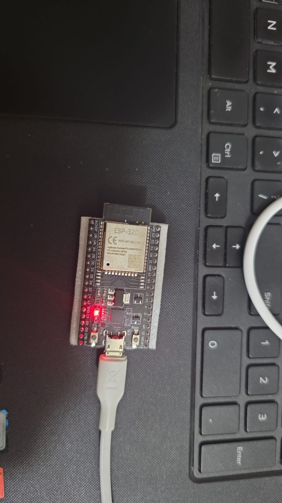

# RL-Adaptive Deception for Post-Quantum IoT Gateways

A reinforcement-learning defender that decides, request by request, whether to send
traffic to a **real ML-KEM-768 (FIPS 203) service running on an ESP32** or to a
**timing-calibrated decoy**, in order to deflect reconnaissance, capture downgrade
attempts, and absorb handshake floods, while keeping legitimate clients on the real service.

**Headline results** (5 seeds × 200 held-out episodes, mean ± std across seeds):

| Policy | Return | Recon deflected | Downgrades captured | Legit false positives | Attacker engagement (steps) |
|---|---|---|---|---|---|
| No deception | −139.8 ± 2.2 | 0.0% | 0.0% | 0.0% | 0.0 |
| Random routing | −178.6 ± 1.3 | 36.4% | 3.0% | 40.2% | 1.6 |
| Static rule | −33.1 ± 1.9 | 76.0% | 32.2% | 0.0% | 4.1 |
| DQN | 12.5 ± 4.2 | 99.5% | 40.0% | 3.0% | 16.4 |
| **QR-DQN** | **15.4 ± 4.4** | **98.6%** | **42.7%** | **0.6%** | **15.6** |

- QR-DQN outperforms the static rule on return (paired t, p < 0.0001) and recon deflection
  (p = 0.0001), at the cost of a small false-positive rate (0.6% vs 0%, p = 0.0115).
- QR-DQN vs DQN: return difference not significant (p = 0.14); QR-DQN has fewer false
  positives (0.6% vs 3.0%, p = 0.0085).
- **Robustness:** QR-DQN beat the static rule in 15/15 runs when reward weights,
  decoy-detection probabilities, or traffic mix were changed by ±50% (`eval/sensitivity_table.md`).
- **Real hardware:** ML-KEM-768 on the ESP32 at 240 MHz takes 8.17 ms KeyGen, 9.39 ms Encaps,
  11.15 ms Decaps (n = 100) with a 15.1 KB peak stack (`docs/hardware_measurements.md`).



<p align="center">
  <br>
  <em>The ESP32 (ESP-32D module) that ran every ML-KEM-768 measurement in this repository.</em>
</p>

## Architecture

```
 attacker / legit client
          │  request (banner | handshake | downgrade | flood)
          ▼
 ┌──────────────────────┐   observation: request type, source history,
 │  RL defender (QR-DQN) │   rate, decoy exposure, episode progress
 └──────────┬───────────┘
   route_real │ route_decoy(lo/hi) │ throttle │ block
          ▼                    ▼
 ESP32 ML-KEM-768 gateway   Python decoy (genuine ML-KEM,
 (PQClean, WiFi, port 5000)  compute time padded to ESP32 measurements)
          │                    │
          └──── logs ──► RF / XGBoost session classifier ──► MITRE ATT&CK tags
```

Latency costs in the RL environment are sampled from the 100 real WiFi handshakes,
not assumed.

## Threat model

- **Attacker can:** grab banners, perform protocol-conformant timing probes (handshakes),
  request a classical ECDH fallback (downgrade), and flood the handshake endpoint.
  Five profiles: scanner, downgrader, flooder, multi-stage (APT), stealthy prober.
- **Attacker cannot:** break ML-KEM, compromise the gateway firmware, or observe the
  defender's internal state. Physical/side-channel attacks on the ESP32 are out of scope.
- **Defender:** sits at the gateway, sees each request with limited source history,
  and chooses one of five actions. Legitimate clients are 35% of requests by default.

## Repository layout

| Path | Contents |
|---|---|
| `firmware/` | PlatformIO project: `bench` (on-device benchmark) and `server` (WiFi ML-KEM gateway) |
| `pqc-service/client.py` | Real ML-KEM handshakes with key confirmation |
| `decoy/decoy_server.py` | Decoy gateway calibrated to ESP32 timings |
| `rl-env/pqc_deception_env.py` | Gymnasium environment (attacker kill chain, defender actions) |
| `agent/` | Training, evaluation, sensitivity analysis, trained models |
| `classifier/` | Session classifier + ATT&CK mapping |
| `eval/` | Raw data (CSV), statistics scripts, result tables |
| `figures/` | Paper figures |
| `docs/` | Hardware measurement details |
| `paper/` | LaTeX draft |

## Reproduce

Tested on Windows 10, Python 3.14, Intel i7-6500U (2 cores, CPU only).

```bash
python -m venv .venv
.venv\Scripts\activate            # Linux/macOS: source .venv/bin/activate
pip install torch==2.14.0 --index-url https://download.pytorch.org/whl/cpu
pip install -r requirements.txt
```

**1. On-device benchmark** (needs an ESP32; set `upload_port`/`monitor_port` in `firmware/platformio.ini`)
```bash
cd firmware && pio run -e bench -t upload
cd ../eval && python log_serial.py COM5
```

**2. Network handshakes** (copy `firmware/src/secrets.example.h` to `secrets.h`, fill in a 2.4 GHz WiFi)
```bash
cd firmware && pio run -e server -t upload && pio device monitor   # note the IP
cd ../pqc-service && python client.py <ESP32_IP> 100
```

**3. Decoy** (optional check)
```bash
python decoy/decoy_server.py 5001
python pqc-service/client.py 127.0.0.1 30 5001 decoy_handshake_test.csv
```

**4. RL training, evaluation, statistics** (~75 min training on a 2-core CPU)
```bash
cd rl-env && python check_env.py
cd ../agent
for %s in (42 123 456 789 1024) do python train.py qrdqn %s 200000 && python train.py dqn %s 200000
python evaluate.py
cd ../eval && python stats.py
```

**5. Sensitivity analysis and classifier** (~3 h)
```bash
cd agent && python sensitivity.py
cd ../classifier && python classify_sessions.py
```

Seeds: 42, 123, 456, 789, 1024. Evaluation episodes use seeds disjoint from training.

## Limitations

- The attacker is simulated from five scripted profiles and is **not deception-aware**
  beyond a per-interaction decoy-detection probability; adaptive adversaries are future work.
- Reward weights and detection probabilities are design choices; the sensitivity analysis
  covers ±50% changes with 3 seeds per condition, not an exhaustive search.
- The decoy matches the ESP32's **compute** timing distribution; matching the **network-path**
  fingerprint requires hosting the decoy behind the same link as the device.
- Single device, single ML-KEM parameter set (768), portable C implementation (no assembly
  optimisation), measured on one shared WLAN.
- Classifier scores (macro-F1 ≈ 0.92) are on sessions from the simulated profiles and do not
  measure real-world detection accuracy.
- The on-device benchmark ran with WiFi off, so the hardware RNG was not fully radio-seeded;
  the networked runs had WiFi on.

## Citation

See `CITATION.cff`, or use GitHub's "Cite this repository" button.

## Acknowledgements

ML-KEM implementation from [PQClean](https://github.com/PQClean/PQClean); client-side
ML-KEM from [kyber-py](https://github.com/GiacomoPope/kyber-py); RL from
Stable-Baselines3 / SB3-Contrib; environment API from Gymnasium.
